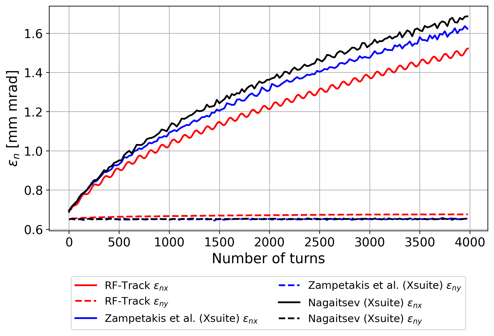
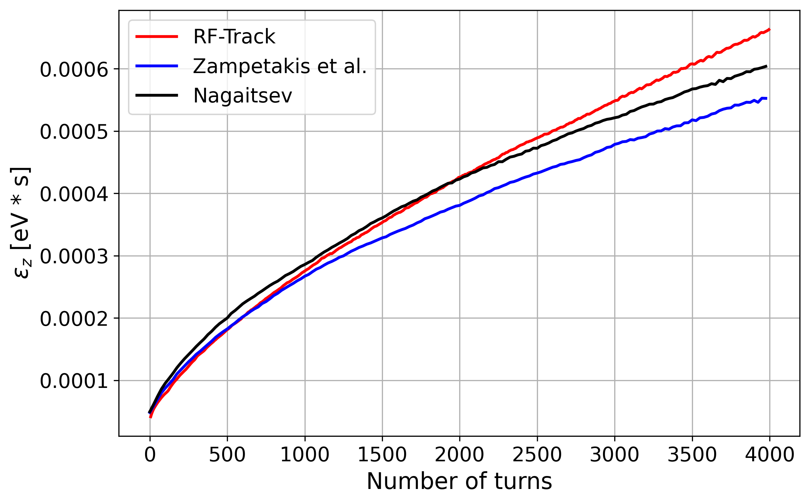

# Intrabeam Scattering Benchmark — RF-Track vs Xsuite

**Authors:** Paula Desire, Andrea Latina

## Overview

This repository contains a numerical benchmark of different intrabeam scattering (IBS) models in an 80 m FODO lattice, associated with the manuscript *A hybrid Monte Carlo model of intrabeam scattering*.

The benchmark compares three IBS implementations:

- **RF-Track:** Hybrid Monte Carlo model developed by P. Desire et al.
- **Xsuite:** Kinetic model developed by Zampetakis et al.
- **Xsuite:** Analytical model based on the Nagaitsev formalism.

Reference simulations without IBS are also included.

## Repository structure

| Directory | Description |
|---|---|
| `lattice/` | FODO lattice definition |
| `tests/` | RF-Track and Xsuite simulation scripts |
| `analysis/` | Post-processing and plotting scripts |
| `final_plots/` | Benchmark results |

## Simulation workflow

1. Generate a common initial particle distribution using `bunch_converter.py`.
2. Run the RF-Track and Xsuite simulations in `tests/`.
3. Analyse the results using the scripts in `analysis/`.

## Results

The benchmark investigates transverse, longitudinal and 6D emittance evolution, as well as the population of non-Gaussian tails.

## Software

- [RF-Track Reference Manual](https://gitlab.cern.ch/rf-track/rf-track-reference-manual/-/raw/master/RF_Track_reference_manual.pdf)
- [Xsuite documentation](https://xsuite.readthedocs.io/)

## Acknowledgements

The authors thank F. Soubelet, S. Kostoglou, H. Bartosik and G. Iadarola for their contributions and discussions.
